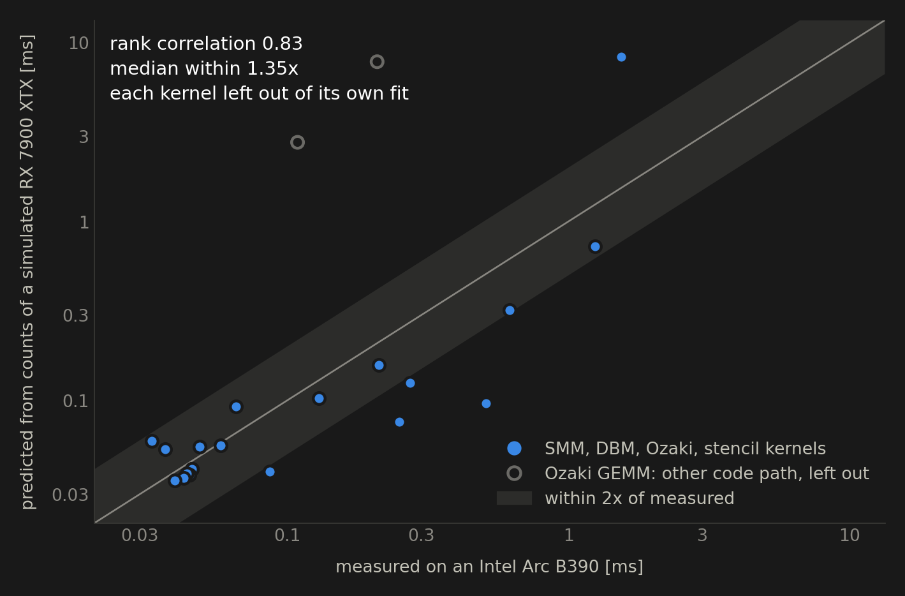
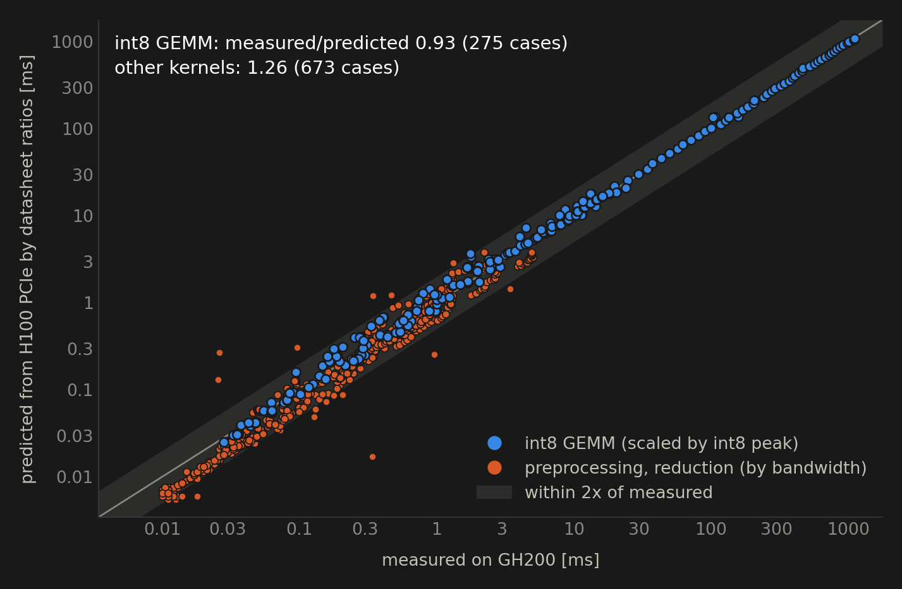
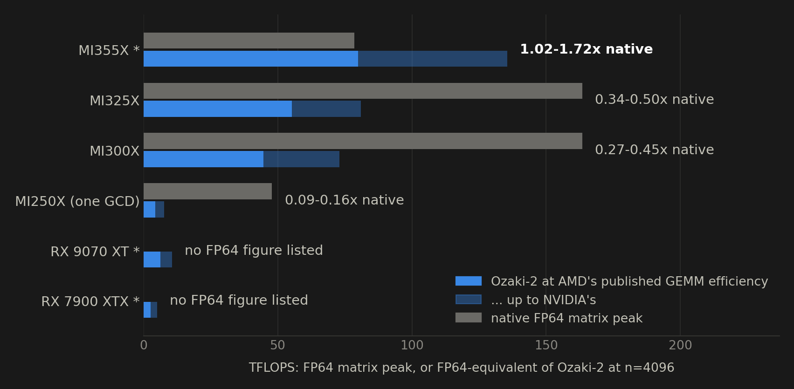
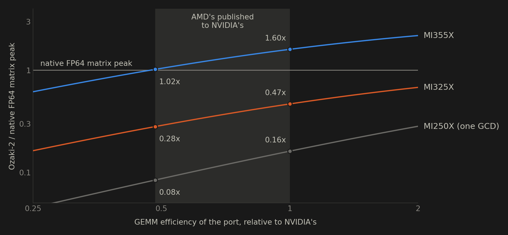
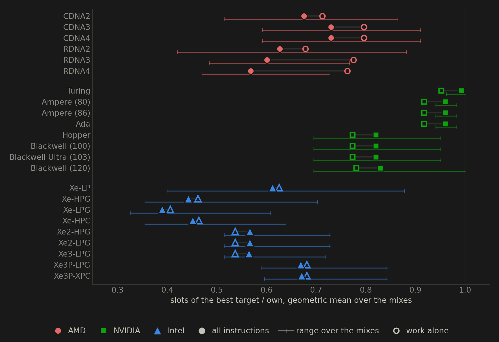

# Counting to Performance

## Simulated GPUs in the loop

LIBXSTREAM with PantheonSim

---

## The idea

- A simulator executes every instruction and **counts** them exactly
- It has **no timing model**: counts say what work was done, not how long
- A few constants **measured on a real device** turn counts into times
- **Datasheet ratios** turn measured times on one device into projections for another
- Every step is a script: build, run, check, count, fit, predict

---

## Setup

- [PantheonSim](https://pantheonsim.com/) runs ROCm's own OpenCL runtime on simulated AMD GPUs: every kernel is built for the card's real target and executed, with no GPU
- **Nine simulated GPUs**, gfx90a to gfx1201: MI250X, MI300X, MI325X, MI350X, RX&nbsp;9070&nbsp;XT, RX&nbsp;7900&nbsp;XTX, RX&nbsp;6900&nbsp;XT, RX&nbsp;6800, RX&nbsp;6700&nbsp;XT
- **Weekly CI** ([amd.yml](https://github.com/hfp/libxstream/blob/main/.github/workflows/amd.yml)) on PantheonSim's 0.2.1 release, checked by its checksum: every sample and atomics variant, the counts, a summary, in six minutes
- [tool_collect.sh](https://github.com/hfp/libxstream/blob/main/scripts/tool_collect.sh) collects times or counts, [tool_score.py](https://github.com/hfp/libxstream/blob/main/scripts/tool_score.py) fits them

---

## First result: a defect on RDNA

FP atomics were chosen by gfx number (`gfx >= 90`), which also matched RDNA.

There the builtins failed; now they are **test-compiled at runtime**:

| Target | fp32 builtin | fp64 builtin |
|---|---|---|
| gfx90a, gfx942, gfx950 (CDNA 2-4) | accepted | accepted |
| gfx1100, gfx1201 (RDNA 3-4) | accepted | rejected: cmpxchg |
| gfx1030, gfx1031 (RDNA 2) | rejected: cmpxchg | rejected: cmpxchg |

<span style="opacity: 0.4; font-size: 50%;">Found by the first CI run and fixed the same day. A rejected builtin is detection, not a failure: LIBXSTREAM_FALLBACK=0 does not refuse it.</span>

---

## What the simulator cannot show

- **No timing**: a compare-and-swap loop shows one attempt (13 more instructions per wave than the native atomic on MI300X), not its retries or latency
- **Memory-scope bits have no effect**: a scope that is too narrow cannot fail
- **Atomics serialize** on a lock; the race detector is NVIDIA-only
- **No sectors or cache lines on AMD**: bytes are what the lanes ask for
- **LDS bank conflicts**: measured on RDNA 2 cards, modelled elsewhere

CI reports **GAP**, apart from ok and FAILED, when the simulator says why it stopped, or when no device is listed: neither a pass nor a failure.

---

## Counts are exact

- **Identical across machines and compilers**: 1026 of 1026 values (GCC&nbsp;13 against GCC&nbsp;14), and 2416 of 2416 (PantheonSim 0.2.1, CI against local)
- One work-group at a time (`VGPU_THREADS=1`): no compare-and-swap retries
- Per launch (`VGPU_DISPATCH_STATS=1`): instructions by kind, **bytes**, the **VALU&nbsp;mix**, matrix work, LDS bank conflicts, and the kernel's **name**

---

## Named mixes

[samples/mixes](https://github.com/hfp/libxstream/tree/main/samples/mixes): kernels that are each a known mixture, validated on every run

| Mix | What it is |
|---|---|
| stream | STREAM triad |
| gemm | GEMM tiled in local memory |
| atomics | FP atomics with the expression the device gets |
| gather | small blocks gathered by index, multiplied in local memory |
| empty | no work over a million work-items: what dispatch costs |

A kernel's counts as a mixture of the mixes counted on the same target:

*c*<sub>k</sub> ≈ Σ<sub>j</sub> α<sub>j</sub> · *c*<sub>j</sub> &nbsp; (non-negative least squares on the count vectors *c*)

*T*<sub>k</sub> ≈ Σ<sub>j</sub> α<sub>j</sub> · *t*<sub>j</sub> &nbsp; (times compose like the counts)

---

## Projecting onto mixes

25 kernels on an **Intel Arc B390**, counts of each simulated AMD GPU:

| Projection, one overlap factor | Rank correlation, PantheonSim before 0.2.1 | With PantheonSim 0.2.1 |
|---|---|---|
| three mixes: stream, gemm, atomics | 0.48-0.56 | 0.68-0.83 |
| five mixes, waves as a category | 0.55-0.72 | 0.70-0.83 |

- **Bytes and the VALU mix** as categories: the mixtures match much better
- Still behind three constants: small kernels do not saturate like the mixes

<span style="opacity: 0.4; font-size: 50%;">One timing campaign throughout; median factor off with PantheonSim 0.2.1: 1.5-2.0. An earlier campaign gave 0.13-0.47 (three mixes, old counts): sensitive to the mixes' times.</span>

---

## What works: three constants

*t* = launch + issue · lane-instructions + memory · bytes

**Each kernel predicted from a fit without it**, on measured B390 times:

| Counts of | Rank correlation | Median factor off | Worst |
|---|---|---|---|
| CDNA 2-4 (MI250X ... MI350X) | 0.81-0.86 | 1.28-1.33 | 3.4-7.0 |
| RDNA 2-4 (RX 6700 XT ... RX 9070 XT) | 0.81-0.83 | 1.33-1.39 | 5.2-5.6 |
| memory instructions instead of bytes | 0.70-0.80 | 1.24-1.51 | 4.5-11.6 |

<span style="opacity: 0.4; font-size: 50%;">Non-negative least squares on relative error, which predicts low: measured/predicted 1.19-1.28 (geometric mean). The Ozaki GEMMs are predicted, not fitted: DPAS on the B390.</span>

---

## Which counts matter

| Terms (each kernel left out of its fit) | Rank correlation | Median factor off | Worst |
|---|---|---|---|
| launch, issue, memory instructions | 0.70-0.80 | 1.24-1.51 | 4.5-11.6 |
| launch, issue, **bytes** | 0.81-0.86 | 1.28-1.39 | 3.4-7.0 |
| ... and FP64 | 0.81-0.85 | 1.19-1.38 | 3.6-7.0 |
| ... and LDS bytes | 0.80-0.87 | 1.22-1.30 | 2.9-7.8 |
| ... and both | 0.82-0.87 | 1.24-1.28 | 3.0-7.8 |

- **Memory**: 0.65-2.1 ps per byte, DRAM's is 17 (60 GB/s): most bytes hit a cache
- **FP64** costs extra on every donor: 0.25-2.1 ps per lane-operation
- Ranges over the nine simulated GPUs; 23 kernels fitted, so few terms

---

## Counts predict real kernel times



---

## Datasheet ratios: H100 PCIe to GH200

[Ozaki-2](https://libxs.readthedocs.io/ozaki/) kernel times (fp64) measured on both; GH200 predicted from H100 PCIe by **dense int8 peak** (GEMM) and **memory bandwidth** (the rest):



---

## Where FP64 emulation pays on AMD

From GH200 by datasheet ratios, with **published** bandwidth and GEMM efficiency where they exist: an Ozaki-2 port (none yet) from AMD's efficiency up to NVIDIA's:



<span style="opacity: 0.4; font-size: 50%;">* Nothing published: the range of MI250X, MI300X, MI325X. Against peak: DGEMM reaches 50% on MI250X, favoring the upper end. Sources: specs.csv, published.csv.</span>

---

## The same, over the port's efficiency

Where each part crosses its native FP64 matrix peak:



<span style="opacity: 0.4; font-size: 50%;">Shaded: AMD's lowest published GEMM efficiency to NVIDIA's, labeled with the curves' values (the bars take each part's own efficiency and, at the top, NVIDIA's memory efficiency). MI300X is 5% below MI325X. Sources: specs.csv, published.csv, ozaki-kernels.csv.</span>

---

## Same mixes, three instruction sets



<span style="opacity: 0.4; font-size: 50%;">Geometric mean over the five mixes (<a href="assets/isa.png">per mix</a>), the line below a score spanning them. Slots per work-item: per wave (AMD), per warp (NVIDIA), per thread (Intel); work alone leaves out what only schedules. Simulated AMD machine code, NVIDIA SASS (ptxas), Intel (ocloc), single precision. Source: isa.csv.</span>

---

## PantheonSim 0.2.1: what we asked for

Requested in a [discussion](https://github.com/pantheongpu/pantheonsim/discussions/631), all exact counts, and what 0.2.1 delivered:

1. **Name, VALU mix, matrix work** on the dispatch line: delivered
2. **Bytes** the lanes ask for, global and LDS: the largest gain
3. **LDS bank conflicts**: delivered; **sectors**: open, until checkable

MI455X (gfx1250): ROCm's OpenCL runtime drops it in 7.1 and 7.2.4 ("Unsupported&nbsp;HSA&nbsp;device"), though ROCm's compiler knows the target.

---

## Reproduce

```text
# times on a device: LIBXSTREAM_PROFILE, per kernel
BIN=bin scripts/tool_collect.sh time out
# counts on a simulated GPU: same cases, same arguments
VGPU_GPU=amd/rx7900xtx BIN=bin scripts/tool_collect.sh count out
# fit and validate (the Ozaki GEMMs predicted, not fitted)
scripts/tool_score.py fit --counts out/counts.tsv --times out/times.csv \
  --leave gemm_fused --leave gemm_crt_fused
# figures of this presentation, from assets/*.csv
python3 documentation/counts/assets/figures.py
```

---

## Next

- Efficiency that depends on size: small kernels do not saturate
- Matrix work (`mops`) and LDS bank conflicts as terms
- OpenCL on simulated NVIDIA GPUs (PoCL's CUDA backend)
- NVIDIA's counts beside the datasheet ratios
- A matrix-engine Ozaki port on AMD, its counts to check the projection
