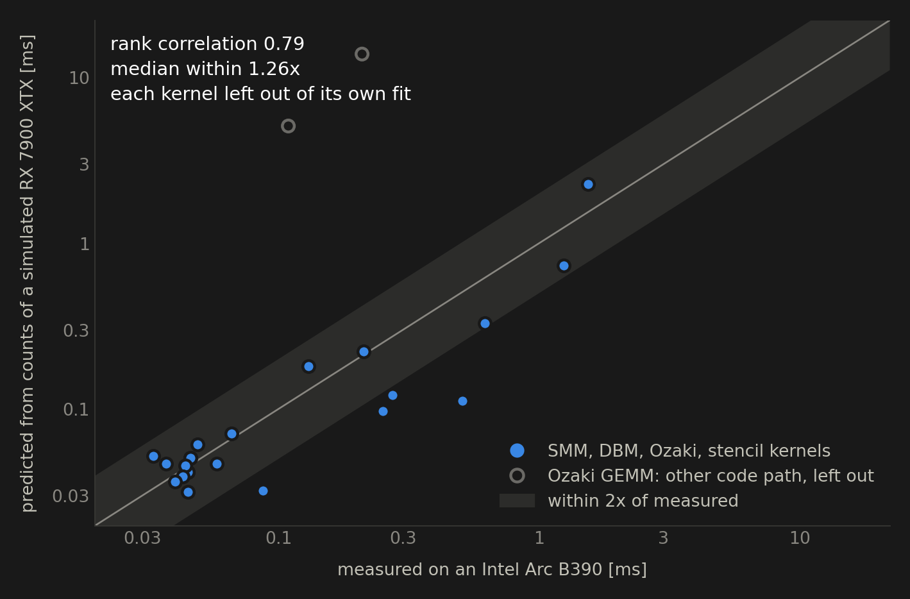
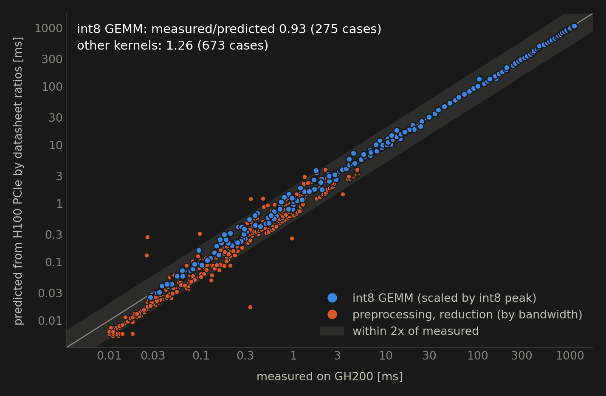
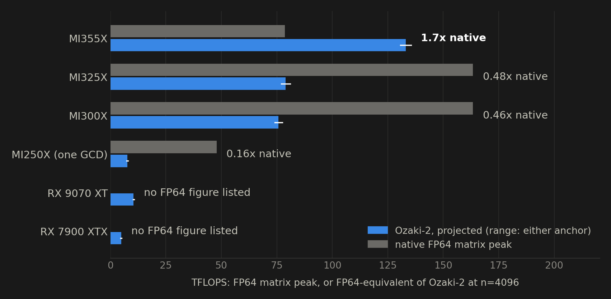

# Counting to Performance

## Simulated GPUs in the loop

LIBXSTREAM with PantheonSim

---

## The idea

- A simulator executes every instruction, so it can **count** them exactly: no sampling, no noise
- It has **no timing model**: the counts say what work was done, not how long it took
- A few constants **measured on a real device** turn counts into times
- **Datasheet ratios** turn measured times on one device into projections for another
- Every step is a script: build, run, check, count, fit, predict

---

## Setup

- [PantheonSim](https://pantheonsim.com/) runs ROCm's own OpenCL runtime (`libamdocl64`, comgr) on its HSA layer: every kernel is built for the card's real target and executed, with no GPU
- **Nine simulated AMD GPUs**: MI250X, MI300X, MI325X, MI350X, RX 9070 XT, RX 7900 XTX, RX 6900 XT, RX 6800, RX 6700 XT (gfx90a to gfx1201); the MI455X (gfx1250) lists no OpenCL device under ROCm 7.2.4
- **Weekly CI** ([amd.yml](https://github.com/hfp/libxstream/blob/main/.github/workflows/amd.yml)): every sample, every FP-atomics variant, the counts, and a summary
- Tools: [tool_collect.sh](https://github.com/hfp/libxstream/blob/main/scripts/tool_collect.sh) (times or counts, same cases), [tool_score.py](https://github.com/hfp/libxstream/blob/main/scripts/tool_score.py) (projection, fit, validation)

---

## First result: a defect on RDNA

FP atomics were chosen by the gfx number (`gfx >= 90`), which also matched RDNA. The AMD builtins did not compile there, and the kernels failed. Now the builtin is **test-compiled at runtime**, once per device and precision:

| Target | fp32 builtin | fp64 builtin |
|---|---|---|
| gfx90a, gfx942, gfx950 (CDNA 2-4) | accepted | accepted |
| gfx1100, gfx1201 (RDNA 3-4) | accepted | rejected: cmpxchg |
| gfx1030, gfx1031 (RDNA 2) | rejected: cmpxchg | rejected: cmpxchg |

<span style="opacity: 0.4; font-size: 50%;">Found by the first CI run and fixed the same day. A rejected builtin is detection, not a failure: LIBXSTREAM_FALLBACK=0 does not refuse it.</span>

---

## What the simulator cannot show

- **No timing**: a native atomic and a compare-and-swap loop look alike
- **Memory-scope bits have no effect**: a scope that is too narrow cannot fail
- **Atomics serialize** on a lock; the race detector is NVIDIA-only
- **No bytes, sectors, or bank conflicts on AMD**: memory counts are instructions per wave

CI reports a run as **GAP**, apart from ok and FAILED, when the simulator says why it stopped, or when the runtime lists no device. A gap is neither a pass nor a failure.

---

## Counts are exact

- Counts of the named mixes are **identical** between CI (GCC 13, Ubuntu) and a local build of the same simulator commit (GCC 14): **1026 of 1026** values
- Counted one work-group at a time (`VGPU_THREADS=1`), so a compare-and-swap loop never retries
- Per launch: waves, instructions, VALU, MFMA, SALU, SMEM, VMEM, FLAT reads, writes, atomics, LDS, branches, barriers (`VGPU_DISPATCH_STATS=1`)
- The kernel's name comes from the launch trace (`VGPU_TRACE_LAUNCHES=1`), paired line by line

---

## Named mixes

[samples/mixes](https://github.com/hfp/libxstream/tree/main/samples/mixes): kernels that are each a known mixture, validated on every run

| Mix | What it is |
|---|---|
| stream | STREAM triad |
| gemm | GEMM tiled in local memory |
| atomics | FP atomics with the expression the device gets |
| gather | small blocks gathered by index, multiplied in local memory |
| empty | no work over a million work-items: what dispatch costs |

A kernel is projected onto the mixes counted on the same target, `c_k ~ sum_j alpha_j c_j` (non-negative least squares), and times compose: `T_k ~ sum_j alpha_j t_j`.

---

## What did not work

Predicting the times of 25 kernels (SMM, DBM, Ozaki, stencil) measured on an **Intel Arc B390** from counts of each simulated AMD GPU:

| Projection, one overlap factor | Rank correlation | Median factor off |
|---|---|---|
| three mixes (stream, gemm, atomics) | 0.48-0.56 | 2.5-3.5 |
| three mixes, waves as a category | 0.55-0.69 | 1.6-2.6 |
| five mixes, waves as a category | 0.55-0.72 | 1.6-2.6 |

- The **waves** category does the work; gather and empty add little beyond it
- The mixes are large and saturate the device, small kernels do not: measured times are **5 to 11 times** the mixtures', and one factor cannot model an efficiency that depends on size
- **Unstable**: an earlier timing campaign gave 0.13-0.47 for three mixes, from identical counts

<span style="opacity: 0.4; font-size: 50%;">Same timing campaign throughout, each simulated GPU's counts in turn.</span>

---

## What works: three constants

`t = launch + issue x (lane-instructions) + memory x (memory lane-operations)`

Fitted on the device's measured kernel times (non-negative, relative error), **every kernel predicted from a fit without it**:

| Counts of | Rank correlation | Median factor off | Worst |
|---|---|---|---|
| CDNA 2-4 (MI250X ... MI350X) | 0.72-0.80 | 1.26-1.50 | 5.4-11.6 |
| RDNA 2-4 (RX 6700 XT ... RX 9070 XT) | 0.79 | 1.26-1.31 | 4.5-4.6 |

<span style="opacity: 0.4; font-size: 50%;">The two Ozaki GEMMs are predicted but never fitted: matrix engine (DPAS) on the B390, vector units on AMD, i.e., different code. Constants on the B390: launch 18-35 us, issue 0-0.56 ps per lane-instruction, memory 4-12 ps per lane-operation. Relative least squares leans toward predicting low: measured/predicted 1.3-1.6 (geometric mean).</span>

---

## Counts predict real kernel times



---

## Datasheet ratios: H100 PCIe to GH200

[Ozaki-2](https://libxs.readthedocs.io/ozaki/) kernel times (fp64) measured on both; GH200 predicted from H100 PCIe by **dense int8 peak** (GEMM) and **memory bandwidth** (the rest):



---

## Where FP64 emulation pays on AMD

The same ratios from both anchors to AMD's datasheets, for an Ozaki-2 port at the efficiency of the NVIDIA one (none exists yet):



<span style="opacity: 0.4; font-size: 50%;">CDNA 4 halved the FP64 matrix rate (163.4 to 78.6 TFLOPS) and nearly doubled int8 (2615 to 5033 TOPS). Compared against peak, not achieved DGEMM, which favors native FP64. Datasheet sources are in assets/specs.csv.</span>

---

## What would make the counts better

All exact, no timing needed:

1. **Kernel name, VALU mix, matrix work in the dispatch line**: already counted (`mix[]` by operation and type, `mops[]` by input type), not printed
2. **Bytes per memory instruction** (active lanes times width): a 16-byte load counts like a 4-byte one today
3. **Sectors and LDS bank conflicts**, as the NVIDIA engine has them

The first would split FP64 from integer work, which matters on parts with slow FP64, and count matrix work by type for a matrix-engine port.

---

## Reproduce

```text
# times on a device: LIBXSTREAM_PROFILE, per kernel
BIN=bin scripts/tool_collect.sh time out
# counts on a simulated GPU: same cases, same arguments
VGPU_GPU=amd/rx7900xtx BIN=bin scripts/tool_collect.sh count out
# fit and validate (the Ozaki GEMMs predicted, not fitted)
scripts/tool_score.py fit --counts out/counts.tsv --times out/times.csv \
  --leave gemm_fused --leave gemm_crt_fused
# figures of this presentation, from assets/*.csv
python3 documentation/counts/assets/figures.py
```

---

## Next

- Efficiency that depends on size: the mixes saturate the device, small kernels do not
- Bytes and the VALU mix, once the simulator prints them
- Counts on simulated NVIDIA targets, to put the counts and the datasheet ratios side by side
- A matrix-engine Ozaki port on AMD, with its counts to check the projection
